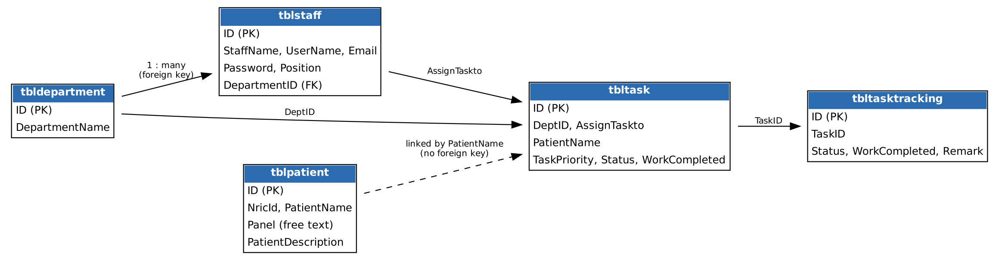

# Clinic Patient and Panel Management System

A web-based system for managing patient records, staff and clinical tasks at a small clinic. It was built as my final-year undergraduate project for a clinic in Sungai Petani, Malaysia, to replace paper record cards kept in filing cabinets.

> **Status:** academic prototype that runs locally on XAMPP. It is not production-ready (see [Limitations](#limitations-and-future-work)). All data in this repository is dummy data.

## The problem

The clinic stored patient details and history on physical cards. Finding a record meant searching full drawers, and nothing could be searched or reported on. The goal was a database-backed system that lets staff register, find and update patients quickly and lets doctors record notes and assign work digitally.

## Features

- **Login and sessions** for clinic staff and doctors, with separate `doctor/` and `staff/` portals and a dashboard in each
- **Patient management:** register, edit, delete and search patients; each record holds NRIC/ID, contact details, address, family contacts, panel and a free-text medical description
- **Patient report view** for doctors
- **Task management:** doctors create tasks linked to a patient (priority, deadline, description) and assign them to staff; staff update status, percentage complete and remarks, and each update is logged in a tracking table
- **Staff and department management:** add, edit and delete, including profile photo upload and live checks for duplicate staff ID, email and phone number
- **Account tools:** change password, password reset form, profile page

## Tech stack

| Layer | Technology |
|---|---|
| Back end | PHP 8 using PDO with prepared statements |
| Database | MySQL / MariaDB (5 tables) |
| Front end | HTML, CSS, JavaScript, jQuery, Bootstrap-based "Pluto" admin template, Chart.js |
| Local server | XAMPP (Apache + MariaDB) |

## Database



Tasks are linked to patients by patient name rather than by ID, which is a known design limitation (see below).

## Running it locally

1. Install [XAMPP](https://www.apachefriends.org/) and start **Apache** and **MySQL** from the control panel.
2. Copy the `doctor` and `staff` folders into `C:\xampp\htdocs\cms\`.
3. Open phpMyAdmin (`http://localhost/phpmyadmin`), go to **Import**, and upload `database/cmsdb_fixed.sql`. It creates the `cmsdb` database.
4. The app connects as `root` with an empty password (the XAMPP default). The settings are in `doctor/includes/dbconnection.php` and `staff/includes/dbconnection.php`.
5. Open the login page:
   - Doctor portal: `http://localhost/cms/doctor/login.php`
   - Staff portal: `http://localhost/cms/staff/login.php`

### Demo accounts (dummy data)

| Email | Password |
|---|---|
| `john@example.com` | `Test@123` |
| `jane@example.com` | `Test@123` |
| `test@example.com` | `123` |

Both portals check the same staff table, so any of these accounts can sign in to either one.

## Project structure

```
clinic-cms/
├── database/cmsdb_fixed.sql     schema + dummy data
├── doctor/                      doctor portal (PHP pages, includes/, css/, js/)
├── staff/                       staff portal (PHP pages, includes/, css/, js/)
└── docs/er-diagram.png          database diagram
```

## Testing

The system was checked with manual functional testing (record creation, update, retrieval and search by name and ID), integration testing across modules, and usability testing of the interface. There is no automated test suite.

## Limitations and future work

This is a student prototype and is **not suitable for real patient data** as it stands. Known issues:

- **Passwords:** hashed with MD5, which is weak. The login page also stores the typed password in a browser cookie ("remember me"), which must be removed.
- **Access control:** roles are not enforced on the server for every page, and delete actions have no CSRF protection.
- **Database:** the app uses the XAMPP default `root` user with no password; a real deployment needs a dedicated user.
- **Data model:** tasks link to patients by name instead of ID, and "panel" is a free-text field rather than its own table.
- **Code structure:** the `doctor/` and `staff/` portals duplicate a lot of code and should share common includes.
- **Planned features:** appointments, and automated tests.

## Credits

Interface built on the open-source "Pluto" Bootstrap admin template. Application logic, database design and clinic-specific modules by Saretha Nagandran.
